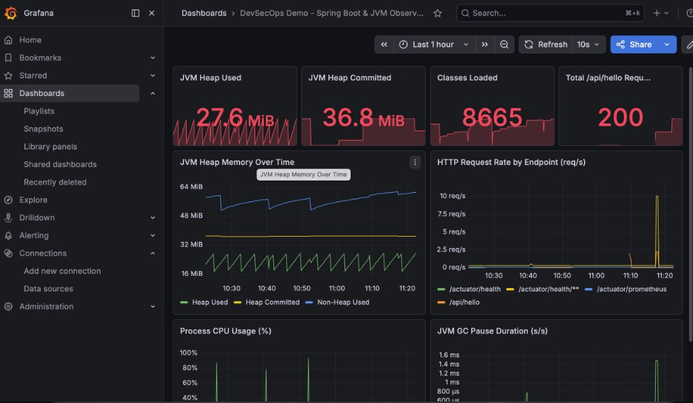
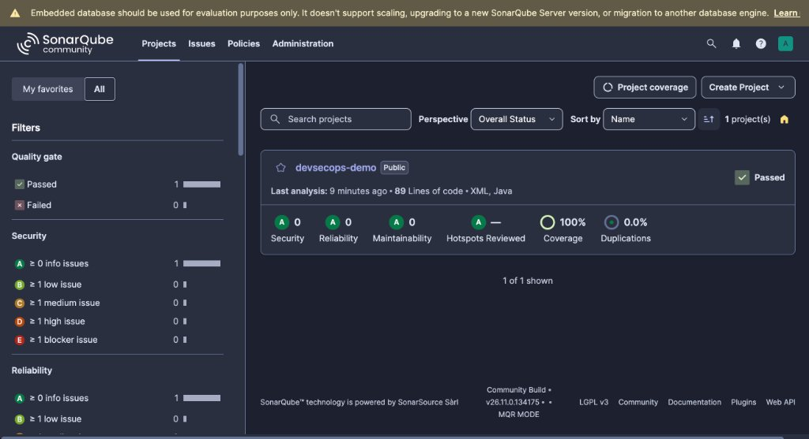
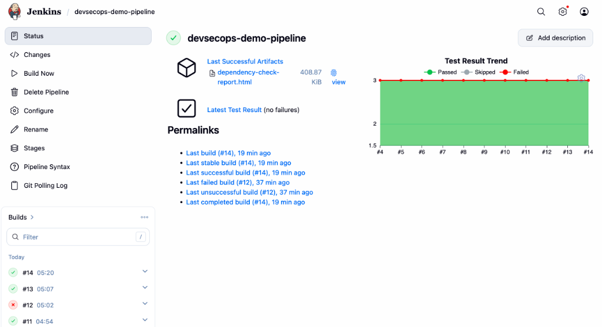
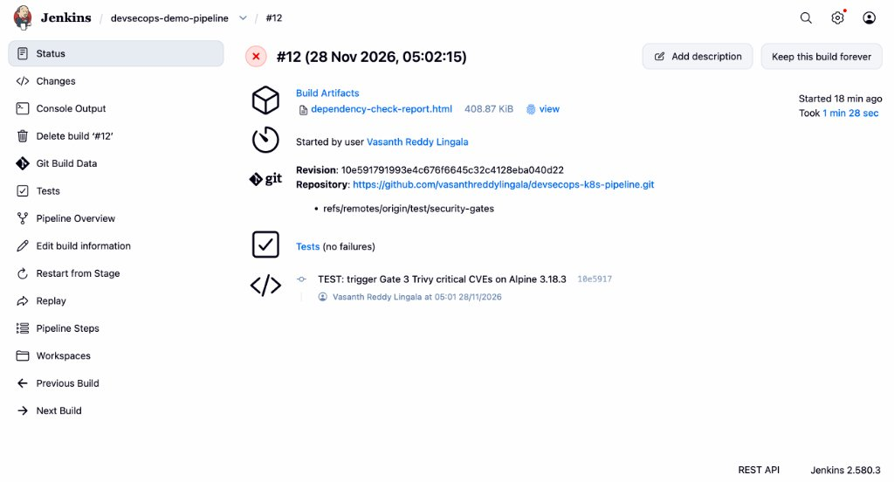

# End-to-End DevSecOps CI/CD Pipeline on Kubernetes (AWS)

Automated, security-gated DevSecOps CI/CD pipeline for a Java 17 Spring Boot microservice on `k3s` Kubernetes in AWS (`ap-south-1`), provisioned with Terraform and configured with Ansible.

## Architecture Diagram

```text
Developer (macOS arm64) ──git push──► GitHub (devsecops-k8s-pipeline)
   │                                         │ Poll SCM (H/5 * * * *)
   │ Terraform / Ansible (SSH :22)           ▼
   └─────────────────────────► AWS EC2 #1: CI Server (t3.medium, 25 GB gp3, IMDSv2)
                                 Jenkins (Java 21) + JDK 17 + Maven + Docker + Trivy
                                 SonarQube 26.11 (:9000) | Prometheus | Grafana (:3000)
                                      │
          ┌─── docker push ───────────┼─── kubectl (:6443, CI SG only) ───┐
          ▼                           ▼                                   ▼
     Docker Hub ────pull────► AWS EC2 #2: k3s Node (t3.small, 15 GB gp3, IMDSv2)
                                Namespace: devsecops | 2x non-root pods (UID 10001)
                                Service: NodePort :30080 (/actuator/health & /prometheus)
```

- **Network isolation:** Admin/UI ports (`22, 8080, 9000, 3000`) allow only the developer CIDR (`terraform.tfvars`); Kubernetes API (`6443`) allows **only** the CI Security Group; Prometheus binds to `127.0.0.1:9090` and connects to Grafana over an isolated Docker network.

## Tech Stack
- **Cloud & IaC:** AWS (`ap-south-1`), EC2, least-privilege IAM (`terraform-user`), Security Groups, IMDSv2, Terraform (`v1.17.2`)
- **Config & Runtime:** Ansible (`2.21.6`), Ubuntu 22.04 LTS, Java 17, Spring Boot `4.2.0`, Actuator, Micrometer, Maven, JUnit 5, JaCoCo `0.8.16`
- **CI/CD & Security:** Jenkins `2.580.3`, SonarQube Community `26.11.0`, OWASP Dependency-Check `12.2.2`, Trivy `0.76.2`
- **Containers, K8s & Monitoring:** Docker, Docker Hub, `k3s v1.37.2+k3s1`, `kubectl`, Prometheus, Grafana OSS (Dashboard `4701`)

## 9-Stage Pipeline & Measured Security Gate Results

| Stage | Tool | Enforcement |
|---|---|---|
| 1. Checkout | Git | Clones `main` (`Poll SCM: H/5 * * * *`) |
| 2. Build & Unit Test | Maven + JaCoCo | `mvn -B clean verify` (3 JUnit tests + coverage XML) |
| 3. **Gate 1 - SAST** | SonarQube | Fails if Quality Gate (`Sonar way comprehensive`) fails (`sonar.qualitygate.wait=true`) |
| 4. **Gate 2 - SCA** | OWASP Dependency-Check | Fails on **CVSS >= 9.0** (`nvdApiKey` cached) |
| 5. Docker Build | Docker | Non-root `eclipse-temurin:17-jre-noble` (`UID 10001`, tag `:${BUILD_NUMBER}`) |
| 6. **Gate 3 - Image Scan** | Trivy | Fails on **fixable `CRITICAL`** CVEs (`--ignore-unfixed --exit-code 1`) |
| 7. Push Image | Docker Hub | Skipped if any gate fails |
| 8. Deploy to K8s | `kubectl` | Applies `k8s/*.yaml` + `rollout status --timeout=240s` |
| 9. Smoke Test | `curl` | Retries `/actuator/health` against `k8s_private_ip:30080` |

### Verified Gate Proof (Measured)
- **Real CVE catch (`#4`):** Gate 2 blocked Spring Boot `3.5.16` (`spring-core 6.2.19`, `tomcat-embed-core 10.1.55`, CVSS `9.1–9.8`). Remediated by upgrading to **Spring Boot `4.2.0`** (`#5` passed).
- **Gate 2 test (`#7`):** Controlled `log4j-core:2.14.1` blocked in `23.87s` (`CVE-2021-44228` CVSS `10.0`, `CVE-2021-45046` CVSS `9.0`).
- **Gate 1 test (`#10`):** Null-dereference bug blocked in `22.51s` (`New issues: 2`, Required `0`).
- **Gate 3 test (`#12`):** `eclipse-temurin:17.0.8_7-jre-alpine` blocked with 2 fixable `CRITICAL` `libexpat` CVEs (`CVE-2024-45491`, `CVE-2024-45492`).
- **Clean recovery (`#13`):** Maven `15.66s`, SonarQube `27.32s`, Dependency-Check `20.68s` → `Finished: SUCCESS`.

## Terraform, Ansible, Kubernetes & Monitoring
- **Terraform (`infra/terraform/`):** Provisions 5 resources (`aws_key_pair`, 2 Security Groups, 2 EC2 instances with encrypted `gp3` EBS & IMDSv2). Never commits `.tfstate` or `terraform.tfvars`.
- **Ansible (`infra/ansible/site.yml`):** Idempotent playbook configuring Jenkins (Java 21 systemd override + JDK 17 builds), 2 GB swap, `vm.max_map_count=262144`, Trivy, `kubectl`, and `k3s`.
- **Kubernetes (`k8s/`):** Namespace `devsecops`, 2 replicas, readiness/liveness probes, CPU/memory requests & limits, `runAsNonRoot: true`, `runAsUser: 10001`, `allowPrivilegeEscalation: false`, `capabilities.drop: ["ALL"]`. Verified zero-downtime rolling update (`1.0.0` -> `1.0.1`) and rollback (`kubectl rollout undo`).
- **Monitoring (`monitoring/prometheus.yml`):** Scrapes `/actuator/prometheus` every 15s; Grafana Dashboard `4701` visualizes JVM heap, GC, threads, CPU, and HTTP request counts.

## Screenshots
1. **Grafana Live Observability (`devsecops-jvm`):**  
   
2. **SonarQube Quality Gate (`Passed`, `100%` Coverage, `A/A/A`):**  
   
3. **Jenkins Pipeline Overview (`#14` & `#13` Green, `#12` Blocked, Test Trend):**  
   
4. **Security Gate Enforcement (`#12` Blocked at Trivy CRITICAL CVEs):**  
   

## Quick Start & Cleanup
1. Copy `infra/terraform/terraform.tfvars.example` -> `terraform.tfvars` with your CIDR.
2. `terraform init && terraform fmt && terraform validate && terraform apply`.
3. Generate `infra/ansible/inventory.ini` from `terraform output` and run `ansible-playbook -i inventory.ini site.yml`.
4. Start SonarQube (`sonarqube:community`), configure Jenkins credentials (`sonar-token`, `nvd-api-key`, `dockerhub-creds`, `kubeconfig`), and run the pipeline.
5. **Cleanup:** `cd infra/terraform && terraform destroy`.

## Key Lessons & Future Improvements
- **Lessons:** Multi-arch `eclipse-temurin:17-jre-noble` resolves Apple Silicon (`arm64`) build mismatches; SonarQube `26.11` defaults Java to `Sonar way core` (`Sonar way comprehensive` needed for strict SAST).
- **Next:** Remote Terraform S3 state, Ingress + TLS (`cert-manager`), Argo CD GitOps, private AWS ECR + IAM/IRSA, JCasC, and Alertmanager Slack alerts.
